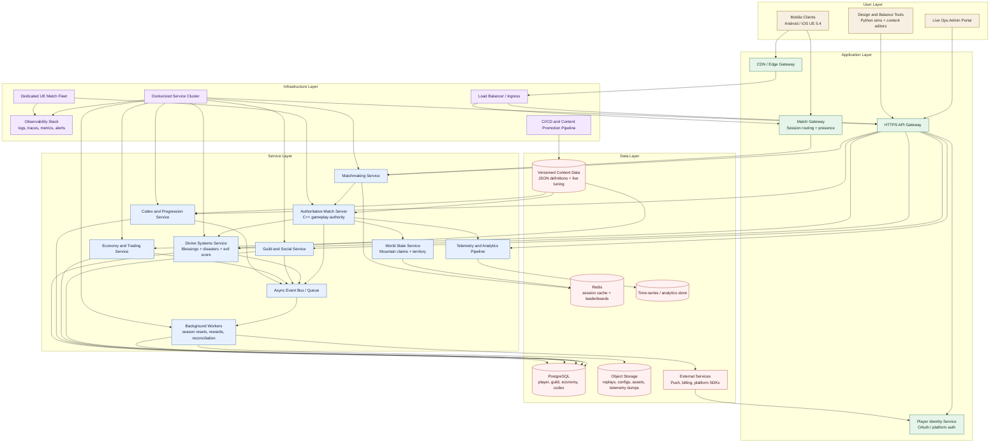

# Epic Architecture Specification: Eternal Summit - Rise of the Ascendants

## 1. Epic Architecture Overview

This architecture defines the first production-grade implementation of Eternal Summit as a mobile-first, server-authoritative multiplayer game platform. The current repository contains Unreal Engine gameplay code, C++ gameplay systems, Python simulation and balance tooling, and JSON-driven content definitions; this document treats REQUIREMENTS.md as the source PRD surrogate because no narrower epic PRD exists in the workspace.

The technical approach centers on five bounded domains: Match Orchestration, World State and Mountain Control, Guild and Economy, Divine Events and Blessings, and Codex and Progression. Runtime authority stays on dedicated game servers for scoring, combat math, territorial control, and divine outcomes, while control-plane and live-ops services manage matchmaking, persistence, analytics, monetization, and social features. The design supports both self-hosted and managed SaaS-style deployment by packaging all backend services in Docker containers and separating latency-sensitive game simulation from web and operations services.

## 2. System Architecture Diagram

## 3. High-Level Features & Technical Enablers

### High-Level Features

- Real-time 16-player King-of-the-Hill matches with 3 to 8 minute authoritative sessions.
- Dynamic mountain control loop with procedural growth, peak capture, and territory scoring.
- Guild building and collective territory ownership for up to 50 players per guild.
- Resource, deed, and economy systems that blend match progression with persistent meta progression.
- Divine interaction model with blessing and disaster events driven by contribution and evil score.
- Codex of Ascendance progression unlocked by specific world interactions and match outcomes.
- Mobile-first rendering and performance scaling across Android and iOS targets.
- Seasonal monetization support for battle pass, essence packs, and divine wards.

### Technical Enablers

- Dedicated authoritative simulation service boundary between match runtime and persistent backend services.
- Matchmaking and session-routing service to place players on low-latency dedicated servers.
- Persistent data model for players, guilds, inventories, codex entries, seasonal progress, and event history.
- Event bus for asynchronous reward payout, telemetry ingestion, guild updates, and divine event reconciliation.
- Versioned content pipeline for JSON-authored blessings, codex pages, heroes, guild trees, and board properties.
- Live-tuning support so balance and event probabilities can change without full client redeploys.
- Observability stack with per-match metrics, gameplay traces, crash reporting, and anomaly alerts.
- Anti-cheat and abuse controls enforced through server-side validation of scoring, trading, and event triggers.
- Build and deployment pipeline that can package Unreal dedicated servers and backend services into repeatable environments.

## 4. Technology Stack

- Unreal Engine 5.4 for the client and authoritative gameplay runtime.
- C++ for low-latency gameplay systems, scoring, combat math, and engine-integrated services.
- Python for simulation, balance tooling, integration tests, content validation, and operational scripts.
- PostgreSQL for durable player, guild, economy, codex, and season state.
- Redis for matchmaking queues, session state, leaderboard caching, and short-lived world snapshots.
- Object storage for replay artifacts, large telemetry batches, content bundles, and live-ops exports.
- Message broker or queue platform such as NATS, RabbitMQ, or Kafka for asynchronous game events.
- OpenTelemetry-compatible logging, metrics, and tracing stack for observability.
- Docker for containerizing backend control-plane services and local development environments.
- Kubernetes, Nomad, or a managed container platform for self-hosted or SaaS backend deployment.
- Platform authentication adapters for Google Play Games, Apple Game Center, and optional first-party account linking.

## 5. Technical Value

**High**

This epic establishes the core runtime, persistence, and live-ops foundations for the product. Without these components, the game cannot safely support authoritative multiplayer, persistent guild systems, divine event processing, or monetized seasonal progression. The architecture also reduces future delivery risk by separating gameplay authority from backend services, which makes scaling, tuning, and operations materially easier over time.

## 6. T-Shirt Size Estimate

**XL**

This is an XL epic because it spans real-time multiplayer runtime architecture, backend service boundaries, persistence design, live-ops infrastructure, observability, mobile performance constraints, and content tooling. It also introduces multiple cross-cutting concerns such as anti-cheat, matchmaking, monetization hooks, and season progression that must be aligned before production launch.